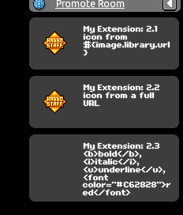
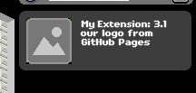
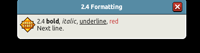
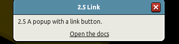
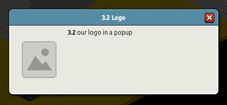
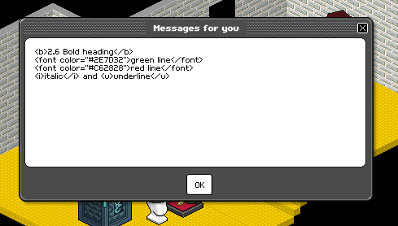

# Showing UI inside the Habbo client

How an extension can put text, pictures and links in front of the user inside the game
client, what was checked on the live client, and the rules that made it work in a
shipped extension.

Live results below: Habbo AIR client, macOS build MAC63-202610151745-513993601,
2026-10-19, G-Earth 1.5.4 with **Developer mode ON**. Nothing was tested with Developer
mode off. Assume it does not work without it (packet safety, `gearth-runtime.md`) and
say so in the extension's README.

## Contents
1. What is possible
2. The packets
3. `NotificationDialog` bubbles
4. `NotificationDialog` popups
5. `MOTDNotification`
6. Images and icons
7. Not tested yet
8. Rules from shipping it
9. Code

## 1. What is possible

**Can't do:**
- **No custom windows or widgets.** G-Python (and every other G-Earth framework) only
  sees packets. It can't add UI code to the client.
- **Don't patch the client `.swf`** (decompile, edit, recompile). That is a modified
  client, not an extension: a bigger ToS risk, it breaks on every client update, it
  breaks the macOS code signature, and every user would need the patched client.
  Advise against it.

**Can do:** send made-up **incoming** packets with `ext.send_to_client(HPacket(...))`.
Nothing goes to the hotel, so only the user of that client sees them, drawn with
Habbo's own windows. For a separate desktop window instead, see
`bugs-and-workarounds.md` section 8 (Tkinter from G-Earth's ▶).

## 2. The packets

All are `in` (server to client). Layouts from HabboPackets; check with
`scripts/habbo_packets.py show <Name>`.

| Name | Layout | What the user sees | Live-tested |
|---|---|---|---|
| `Whisper` / `Chat` | see `packets.md` section 5 | a chat bubble in the room | not in this round |
| `NotificationDialog` | `s type, i[s key, s value]` | a bubble (toast) or a popup window, by the `display` key | `BUBBLE`, `POP_UP` |
| `HabboBroadcast` | `s message` | a modal alert | no |
| `MOTDNotification` | `i[s]` (one string per page) | the "Messages for you" window, multi-page | yes |
| `InClientLink` | `s link` | opens one of the client's built-in windows | no |

`type` in `NotificationDialog` is a free string; nothing visible depended on it. Use
your extension's name.

## 3. `NotificationDialog` bubbles

`display=BUBBLE`: a toast at the top right that fades by itself.

| Key | Result |
|---|---|
| `message` | the text. **HTML tags are printed raw** (`<b>` shows as text): plain text only |
| `image` | the icon on the left. Works with a `${image.library.url}...` placeholder, a full `https://images.habbo.com/...` URL, and an image on your own HTTPS site |





```python
HPacket("NotificationDialog", "my_extension", 3,
        "display", "BUBBLE",
        "message", "My Extension: settings saved.",
        "image", "${image.library.url}album1584/ADM.gif")
```

## 4. `NotificationDialog` popups

`display=POP_UP`: a window with a title bar and a close button. It stays until the user
closes it.

| Key | Result |
|---|---|
| `title` | the title bar |
| `message` | the text. `\n` line breaks work. **Formatting works:** `<b>`, `<i>`, `<u>`, `<font color="#C62828">` |
| `image` | a picture on the left (same URL forms as bubbles) |
| `linkUrl` + `linkTitle` | an underlined link-button; clicking it opened the system browser |

Because the popup reads markup, **escape any text you didn't write** (player names,
chat, API answers) with `html.escape` before putting it in `message`.







```python
HPacket("NotificationDialog", "my_extension", 5,
        "display", "POP_UP",
        "title", "My Extension",
        "message", f"<b>Status:</b> <font color=\"#2E7D32\">ON</font>\n"
                   f"<b>Room:</b> {html.escape(room_name)}",
        "linkUrl", "https://example.com/docs",
        "linkTitle", "Open the docs")
```

## 5. `MOTDNotification`

The "Messages for you" window with an OK button. **Plain text only**: tags are printed
raw. Line breaks work. Popups (section 4) do everything this does, plus formatting, so
prefer them.



## 6. Images and icons

- **Habbo badges:** `https://images.habbo.com/c_images/album1584/<BADGECODE>.gif`, or
  `${image.library.url}album1584/<BADGECODE>.gif` (the client expands the placeholder).
- **Your own image:** any HTTPS URL. A PNG on GitHub Pages was tested live and loaded;
  `raw.githubusercontent.com` also served the PNG fine (not tried in the client).
- Bubbles show the image as a small icon; popups show it larger, on the left.

## 7. Not tested yet

`HabboBroadcast`, `InClientLink`, `display` values other than `BUBBLE` and `POP_UP`,
`linkUrl` with `event:` links, and anything with Developer mode off. Test on an alt
account before relying on them, then update this file with the build and date.

## 8. Rules from shipping it

- **Owner-only command.** Intercept the user's own outgoing `Chat`, `Shout` and
  `Whisper`. If the text starts with the prefix as a whole word (compare the first word,
  so `/bbq` doesn't match `/bb`), set `msg.is_blocked = True` so the room never sees it,
  then queue the window.
- **Send off the callback thread.** Client-bound packets go through one dedicated thread
  with a bounded queue (20, drop the oldest when full) and a ~0.3 s gap between sends.
  Never call `send_to_client` from an intercept callback.
- **Throttle repeats.** Show the same notification key at most once per N seconds (10 s
  default), and give each kind (errors, cooldowns, config changes, ...) its own config
  toggle.
- **Check the name first.** Before each send, confirm the name is in
  `ext.packet_infos[Direction.TO_CLIENT]`. With an unknown name, g-python 0.1.6 doesn't
  raise and `send_to_client` returns None: it only prints `Could not send incomplete
  packet` to stderr. Treat a False return (other versions) as a failure too. On failure,
  fall back to `write_to_console` once per session.
- **Bubbles for automatic notices, popups for things the user asked for** (help,
  status). Bubbles fade on their own; popups stay until closed, so don't push them
  unasked.
- **Developer mode.** Tell the user to turn it on (G-Earth's Extra tab) in the README
  and in the console fallback message.

## 9. Code

The template has all of this in `assets/gpython-template/src/__PKG__/hotelui.py`, with
tests in `tests/test_hotelui.py`:

| Name | Does |
|---|---|
| `build_dialog(params)` | any `NotificationDialog` from a dict |
| `build_bubble(message, title=, image=)` | a bubble; text cleaned and cut to 160 characters |
| `build_popup(message, title=, image=, link=)` | a popup; keeps line breaks, cut to 1500 characters |
| `escape(text)`, `colour(text, RED)` | safe text and coloured markup for popups |
| `badge("ADM")` | badge image URL with the client placeholder |
| `HotelNotifier` | the `ext-notify` thread: bounded queue, gap, repeat throttle, kind toggles, name check, console fallback |

The example app's `!help` command shows the owner-only pattern: blocked, then
`self.hotel.send(build_popup(...))`.
